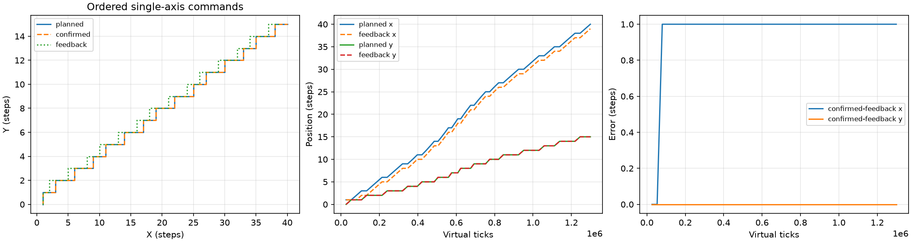
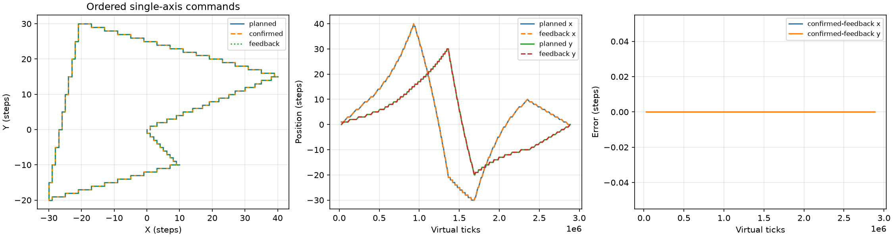
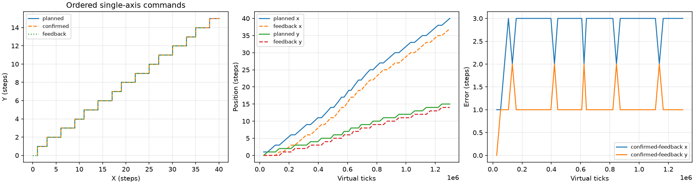

# V2.3 双轴虚拟时钟与运动仿真验收

2026-10-12：`V23_SOFTWARE_SCOPE = COMPLETE`。只验收主机软件仿真；L4 `NEEDS HARDWARE`，L5 `POWER-STAGE ENABLE BLOCKED`。

基线：启动时 fetch 并核对 PR #2 的实时 HEAD `bf75328eb92b387306919e9ce6e31a7bcfe450a6`。分支 `feat/v23-motion-virtual-time`；[PR #3](https://github.com/xu2005/DMF407_FOC_HAL/pull/3) base 为 `feat/legacy-motion-v1-20261011`。原目录的未跟踪 `Docs/V2.2_Trae_独立软件与云端交付审计_2026-10-11.md` 保留，开发隔离在相邻 `DMF407_FOC_HAL_v23` worktree；没有清理用户文件。

## 实际实现与契约

- `Motion/motion_scheduler.[ch]` 合并虚拟时钟和调度器：纯 C、uint64 单调 ticks，无 HAL、真实等待和动态分配。每步只调用一次 `Motion_Next`，验证事件、按实际 period 推进，再通过同步 sink 接收并调用 `Motion_Confirm`。单步、分批与运行至结束共用同一执行路径。
- `Motion/motion_virtual_plant.[ch]`：X/Y 整数步位置独立更新；每步编码器计数比、计数量化、初始计数偏置可配置；反馈由独立模型生成。可注入指定序列单轴拒绝、一次已接收但未执行、最多 64 个已接收命令样本的反馈滞后。
- `App/app_motion_v23_host.c`：独立主机程序，10 种场景导出逐事件 CSV。`scripts/v23_export_trajectory.py` 检验序列、周期增量、轴步进、确认位置、反馈误差和场景结果，生成统计及可选 PNG。只有 Python 标准库为必需，matplotlib 为绘图可选依赖。
- Host CMake 登记 14 项 `V23_SIM`；云端原 Debug/Release workflow 增加真实 C 程序的轨迹导出及 artifact 上传。

`planned` 是 Motion 规划步数，`confirmed` 是 sink 成功接收的逻辑位置，`plant` 是虚拟执行器位置，`feedback` 是虚拟编码器位置；CSV 同时记录四者。`error_x/y = planned - feedback`；`confirmed_error_x/y = confirmed - feedback`。摘要另列 `target - feedback` 和该末端误差的欧氏长度，拒绝/取消时不会把确认误差为零误写成到达目标。

位置与误差单位为逻辑 steps（反馈可有小数），encoder 单位为虚拟 counts，时间单位仅为 `virtual_ticks`。默认无秒换算；可选 `--tick-hz` 只定义展示用理论时间基准，不是 TIM4 实测标定。一次事件只有一轴步进，图中的几何协调不能证明物理同时脉冲或同步精度。

调度器与 Motion 为单主体串行上下文；sink 不得修改 Motion 或保留事件指针。sink 中重新调用 Step/Run 返回 `SCHED_BUSY`。外部 pending、错序/序列溢出、非法事件、零 period、时间溢出均故障停止，溢出/零周期不派发。拒绝调用 `Motion_Confirm(...,0)` 并锁存故障。取消清除 pending/队列。单次 Run cap 返回可恢复 `SCHED_LIMIT`，生命周期 event_budget 耗尽则锁存 `SCHED_BUDGET`，以后不再派发；Run 到结束传剩余预算即可。cap=0 不消耗事件。初始化只允许已 Start 且无 pending 的 Motion。

编码器量化将有符号计数向零截断到 quantum 整数倍；偏置保留在反馈中，不自动校零。滞后按已接收命令样本计算，与 ticks 到秒无关；停止后保持最后样本，不假设按真实时间自动收敛。counts_per_step/quantum 必须正且不超过 INT32_MAX，位置边界拒绝，环形历史容量固定 65。该模型没有惯量、摩擦、电流、PMSM 或 FOC 动力学，参数为演示选择而非测参。

## 真实验证

受测代码提交：`9e02b8645f7b6580fc999ff3dddbcef77a9f54b9`。其后仅增加验收、交接和已有证据；最终发布 HEAD 以 PR 实时 `headRefOid` 为准，不把受测代码 SHA 冒写成文档提交 SHA。

| 验证 | 结果 |
| --- | --- |
| 调度定向 | 5/5：冻结 Legacy 单段完整序列/周期哈希、逐步与批量确定性、10,001 事件分批、生命周期预算、取消/故障、零周期/时间溢出/pending/错序/序列溢出、sink 重入 |
| 虚拟执行器定向 | 5/5：单轴隔离、X/Y 拒绝、X/Y 负向漏步、滞后、计数比/量化/偏置/参数与位置边界 |
| 时序反馈集成 | 4/4：纯 X/Y、45°、不等斜率/四象限几何界限、反向多段/原点/零段、100 槽容量与再次装载、8192 事件 |
| Host Debug | 118/118，原 104 项完整保留 |
| Host Release | 118/118，原 104 项完整保留 |
| 标签保留 | 每模式 18 项 V22_MOTION、3 项 KNOWN_RISK、14 项 V23_SIM |
| CSV 确定性 | 10 组 Debug/Release 的完整 CSV 均逐字节一致，时间增量逐行断言 |
| 图表 | 两模式各 9 张 PNG；已目视检查 mixed/drop/lag 的坐标、图例、时间/误差单位与反馈分离 |
| ARM 矩阵 | 本轮未执行：根 CMake、固件源/链接路径、默认 App 与安全配置均无修改；新增库/主机程序仅登记在 tests/host |

3 项风险 `encoder_r01`、`math_angle_r01`、`svpwm_zero` 继续是风险复现，不是风险关闭。未修改 Legacy、原 Motion/Profile、Core、BSP、Motor、Control、.ioc、根 CMake、V2.2 App。原 S 曲线全表/XY 单段多段冻结回归随完整 104 项运行。

本机摘要、命令/退出码、JUnit 与原始日志：`build/v23-evidence/`；精简归档：[summary.json](审核证据/v23_20261012/summary.json)、[commands.json](审核证据/v23_20261012/commands.json)。完整 CSV/PNG 在 `build/v23-trajectory-debug/` 与 `build/v23-trajectory-release/`；云端 artifact 包含完整 CSV/summary。没有重复依赖全仓哈希。

## 仿真统计

| 场景 | 派发/接收 | 总 ticks | 最终 plant | 最终 confirmed-feedback (steps) | 终态 |
| --- | --- | --- | --- | --- | --- |
| Legacy 4096×2 X | 8192/8192 | 25,095,835 | (8192,0) | (0,0) | COMPLETE |
| 多段四象限回原点 | 260/260 | 2,886,718 | (0,0) | (0,0) | COMPLETE |
| 第 3 命令漏执行 | 55/55 | 1,298,763 | (39,15) | (1,0) | COMPLETE |
| 第 3 X 拒绝 | 3/2 | 80,145 | (2,0) | (0,0)，目标剩余 (38,0) | FAULT |
| 第 3 Y 拒绝 | 3/2 | 80,145 | (0,2) | (0,0)，目标剩余 (0,38) | FAULT |
| 4 样本反馈滞后 | 55/55 | 1,298,763 | (40,15) | (3,1)，反馈 (37,14) | COMPLETE |
| 偏置与量化 | 55/55 | 1,298,763 | (-40,15) | (-1,0.625) | COMPLETE |
| 长 X | 12000/12000 | 35,986,715 | (12000,0) | (0,0) | COMPLETE |
| 零长度 | 0/0 | 0 | (0,0) | (0,0) | COMPLETE |
| 第 8 事件取消 | 8/8 | 213,720 | (8,0) | (0,0)，目标剩余 (8184,0) | CANCELLED |

滞后最大绝对误差 X/Y=(3,2) steps，最终末端误差 sqrt(10) steps；量化案例最大=(1,0.875) steps，最终末端误差约 1.17925 steps。完整统计含其余场景最大/最终误差。COMPLETE 只表示命令队列消费完毕，漏步/滞后仍可能存在反馈偏差。







## 复现与发布

从 V2.3 worktree 根运行（cmake/ninja/gcc/ctest 在 PATH，python 可替换为本机解释器绝对路径）：

```text
python scripts/v23_validate.py
python scripts/v23_export_trajectory.py --exe build/v23-host-debug/motion_v23_demo.exe --out build/v23-trajectory --plot
```

Linux 程序去掉 `.exe`。仅 C 定向：`ctest --test-dir build/v23-host-debug -L V23_SIM --output-on-failure`。本机绘图依赖安装于忽略的 `build/v23-python-deps`，通过 PYTHONPATH 可复用；新环境不安装 matplotlib 也可运行 C/CSV/摘要。

代码提交的真实 Push Linux Debug/Release CI [38193325572](https://github.com/xu2005/DMF407_FOC_HAL/actions/runs/38193325572) 已 SUCCESS。文档发布会产生新 HEAD 和新 CI，最终状态在 PR 回读后记录于 PR 正文；用 `gh pr view 3 --repo xu2005/DMF407_FOC_HAL --json headRefOid,baseRefName,statusCheckRollup` 可核验，不能沿用上述较早运行替代最终提交证据。

硬件未完成事项见 [V2.3_待硬件确认事项](V2.3_待硬件确认事项.md)。本轮没有烧录、实体输出、母线/电机试转、自动化任务或 PR 合并。
